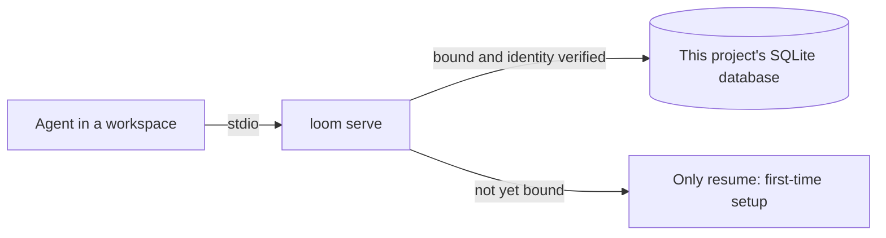

# Loom

**[简体中文](README.zh-CN.md)**

Local project memory and source-dependency evidence for coding agents. Loom keeps decisions, constraints and lessons in a project-bound SQLite database, builds a separate, rebuildable source index, and retrieves the relevant context when work needs it.

Code can tell an agent what exists; it rarely explains why a decision was made or where an interrupted task stopped. Loom preserves that information without turning every session into a replay of the entire project history.

- **Local by default.** One executable; no database server, model service or network required for the core workflow.
- **Traceable dependencies.** Follow a file reference back to its line in the file that uses it. Results distinguish definite and possible relationships and identify gaps in the indexed snapshot. This is a file-dependency graph, not a function call graph.
- **Context before an edit.** One request returns confirmed constraints, files used by or depending on the target, recorded file responsibilities, relevant memories and anything the index could not establish.
- **Human-controlled knowledge.** Proposals do not become constraints automatically; source changes flag anchored knowledge for review. Optional model retrieval stays off until enabled.

[Install](#install) · [Quick start](#try-it-in-a-project) · [Workflow](#workflow-and-feature-map) · [MCP client setup](doc/MCP/clients.md) · [Storage and models](#optional-storage-and-models) · [Evidence and limits](#evidence-and-current-limits)

> CLI help, bundled `loom guide` instructions and human-readable command/tool output are currently Chinese. English memory content works unchanged. For English agent onboarding, use the prompt below and the [English MCP guide](doc/MCP/README.md).

## Install

### From source

Requires **Rust 1.89 or newer** (the declared minimum), Cargo and a native C/C++ compiler/linker. The workspace uses **Rust edition 2024** and bundles SQLite. Start at the root of the checkout containing this README; if you are reading it on a branch or tag, build that revision rather than an older default branch.

```bash
cargo install --path crates/loom-cli --locked
loom --version
loom context --help
```

The package is **`loom-cli`**; the installed executable is **`loom`**. Do not use `cargo install loom` for this repository. Ensure Cargo's binary directory is on `PATH`, or use the executable's absolute path.

For a build without installation, use `cargo build --release --locked -p loom-cli`; the result is `target/release/loom` (`loom.exe` on Windows). On Windows/MSVC, build in an x64 Developer PowerShell with Visual Studio C++ Build Tools and the Windows SDK loaded. A missing `kernel32.lib` (`LNK1181`) usually means that SDK or developer environment is missing.

The workspace version is `0.1.0`; there are currently no version tags. Development builds share that version: if `context --help` fails, rebuild from current source or request an updated offline package. These instructions do not assume a published registry package or release. Core operation after installation is offline; fetching build dependencies is not.

### Windows offline package

If you have a trusted, architecture-matching `loom-windows-*.zip` and its matching `.zip.sha256`, no Rust installation or `PATH` change is needed. Put that pair in a new directory containing no other ZIPs, then run PowerShell there:

```powershell
$zips = @(Get-ChildItem -LiteralPath . -File -Filter 'loom-windows-*.zip')
if ($zips.Count -ne 1) { throw 'Expected exactly one Loom ZIP.' }
$zip = $zips[0]
$hash = (Get-FileHash -LiteralPath $zip.FullName -Algorithm SHA256).Hash
$expected = (Get-Content -LiteralPath ($zip.FullName + '.sha256') -Raw -ErrorAction Stop).TrimEnd()
if ($expected -ine "$hash  $($zip.Name)") { throw 'Checksum or filename mismatch.' }
if (Test-Path -LiteralPath '.\loom-app') { throw 'Choose a new extraction directory.' }
Expand-Archive -LiteralPath $zip.FullName -DestinationPath '.\loom-app' -ErrorAction Stop
.\loom-app\loom.exe --help
.\loom-app\loom.exe context --help
```

A matching sidecar detects corruption; it is **not a publisher signature**. Establish trust in the package separately. If Windows reports a missing VC runtime, request a self-contained build rather than downloading individual DLLs. The [offline guide](docs/WINDOWS-QUICKSTART.md) covers first-run checks and packaging; this README does not assume a public download exists.

The examples below assume `loom` is on `PATH`. Otherwise substitute its absolute path; in PowerShell, invoke a quoted path with `&`.

## Try it in a project

Start in an **existing project's root**. Replace `src/store.ts` with a supported source file that actually exists in your project. The sample memory is troubleshooting guidance; replace it with a lesson or decision you want to retain.

```bash
cd /path/to/existing-project

loom --root . init
loom stats
loom index

loom remember GOTCHA "Check transaction lifetime before increasing timeouts" "When investigating lock contention, check transaction lifetime before raising timeouts; longer timeouts can hide the cause." --anchor src/store.ts
loom recall "transaction lifetime"

loom context src/store.ts --mode impact --question "transaction lifetime" --budget 3000
```

1. **Check identity first.** `init` and `stats` must show the same project ID and root. `stats` also shows the database location and size. Initialization creates the local `.loom/` metadata and database, not a hosted account.
2. **Check retrieval.** `recall` should return the saved title and its ID. `loom manage get <id>` retrieves the full record; do not save a second copy just to retrieve it.
3. **Use the context to plan the change.** Before altering retry behavior in `src/store.ts`, check which files reference it and on which lines. Use that evidence, confirmed constraints and anchored lessons to choose what to inspect or test. An empty list is not proof that the file is safe to delete.
4. **Refresh after editing.** Run `loom index` again, then repeat `context`. Use `--mode explain` for the opposite direction: the files `src/store.ts` itself references. Omitted evidence can be inspected with `loom context src/store.ts --mode impact --json`; JSON removes text-preview omissions, not traversal limits.

**Path rules:** `init` requires an explicit `--root`. After binding, commands run from a subdirectory find the nearest bound ancestor; file arguments remain relative to the **project root**, not the current directory. Outside the project, supply `--root /path/to/project`. Ordinary queries never initialize a database on your behalf.



An unbound workspace does not silently create a database. If a known database is missing or a project ID does not match, stop and check the binding rather than initializing a replacement.

Keep `.loom/` out of version control using `.gitignore` or the repository's local `.git/info/exclude`. It contains local knowledge, not just a disposable index. Use selective sharing when records need to leave the project.

## Workflow and feature map

| Need | Entry points | What matters |
|---|---|---|
| Preserve a decision or a hard-won lesson | `remember`, `recall`, `manage` | Recall before writing. Anchor records to files; archive or supersede obsolete conclusions rather than silently overwriting history. |
| Plan a file change | `context`, `explain`, `impact`, `index` | Look upstream for dependencies or downstream for files that use the target. Refresh explicitly; distinguish static evidence, likely candidates and unresolved references. |
| Establish project constraints | `intent`, `overview` | Proposals are inactive until explicitly confirmed. Importance and pinning are not confirmation. |
| Describe a file's role | `note` | Roles have source-fingerprint baselines. Reindexing does not count as human review. |
| Continue interrupted work | MCP `resume`; `canvas` | Persist a goal, next step and evidence location. Recent memories are not a task list. |
| Inspect support or disagreement | `evidence pack`, MCP `evidence` | Only explicitly declared relationships count as support or conflict; similar wording is not proof. |
| Transfer selected knowledge | `share preview`, `share export`, `share import`; `import` | Review exact records and their digest. Incoming intents remain proposals. Legacy wiki import is not synchronization. |

`context` is read-only and does not save its question or call a model. Its default budget is **1,500 UTF-8 bytes**, adjustable up to **6,144**—not tokens. `--question` supplies space-separated memory keywords. Selection prioritizes file anchors, then keyword matches; a textual mention is not a verified file association.

### How to read structural results

Supported evidence covers Rust modules and some local references; JS/TS, JSX/TSX and Vue script imports; Python imports; Go packages and package-level names; Java imports and type names; and C/C++ includes. Vue templates, arbitrary runtime loading and precise symbol-level call graphs are outside that scope.

- `index` publishes an explicit snapshot. Queries do not refresh it or run a background watcher. Their live checks cover at most 32 involved source files, not the whole project, and cannot discover newly added files.
- Results separate definite evidence, likely relationships and ambiguity. A TypeScript alias or a literal dynamic import can yield a useful candidate without proving the runtime dependency. Default traversal is one hop, at most three.
- Git-managed projects follow repository ignore rules; `.loom/ignore` adds exclusions. Nested projects, directory links and dependency/cache environments are excluded. Files over 1 MiB, unreadable files, unsupported encodings and parse failures leave coverage gaps.
- “No relationship in this snapshot's managed scope” does not mean “no relationship in the current project.” Changed inputs, unresolved references, coverage gaps and retrieval limits remain part of the answer. Inspect them before acting; reindex when requested.

## Connect an agent through MCP

`loom serve` is a **stdio MCP server** launched by the client. It does not listen on a port. A process serves one project; each tool call resolves and verifies that project's identity and opens the database only for the call.

Register the executable with arguments `['serve']` when the client launches it in the project directory. If it launches elsewhere, use project-specific arguments `['--root', '/absolute/project/root', 'serve']`. **Do not hard-code one project's root in a user-wide configuration shared by all projects.**

- **[English MCP guide and quick workflow](doc/MCP/README.md)**
- **[MCP 中文指南](doc/MCP/README.zh-CN.md)**
- **[Client setup: ZCode, Claude Code, Codex, Pi and dsh](doc/MCP/clients.md)**

After connecting, call `resume` and verify the reported root and project ID. An unbound project exposes only `resume`, which directs the agent to `loom guide`; it creates nothing automatically. After explicit initialization, the same server can expose all 17 tools. Reconnect if the client does not refresh its tool list. If a connection points at the wrong project, fix its root before reading or writing knowledge.

### Compact English instructions for `AGENTS.md` or `CLAUDE.md`

Add this to the instruction file your client actually reads; client registration is a separate step.

```markdown
## Project memory and structure: Loom

- Start with `resume`; verify the project ID/root. If no opening overview was delivered, call `overview` explicitly for confirmed goals and constraints.
- If unbound, follow `loom guide` to initialize the intended root and index it. Ask before changing client/host configuration. Bundled guides and output are currently Chinese.
- Before changing a file, call `context` with its root-relative target. Use mode=impact for files that reference it, or mode=explain for files it references. Preserve gaps, uncertainty and drift warnings in your conclusions.
- Run `index` after a batch of source changes, or when a query asks for it. A snapshot-scoped miss does not prove project-wide absence.
- Recall before remembering. Save reasons, root causes and lessons that code alone cannot explain; anchor them to relevant files. Track unfinished work with `canvas`.
- Ask for explicit approval before confirming/revoking/replacing intents, reviewing file roles, moving storage, enabling/changing models, importing/exporting or deleting knowledge.
- Never request secret values in chat or put them in command arguments or repository files. Direct the user to `loom config secret embedding` or `loom config secret rerank` when needed.
```

## Optional storage and models

### Put the database where it belongs

The default is `.loom/loom.db`. The project marker remains in `.loom/project.id`; an external database location is remembered in `.loom/database.path`. `loom stats` shows what is actually in use.

| Change | Command |
|---|---|
| Locate user configuration | `loom config path` |
| Choose a database for a new project | `loom --root . init --db /path/to/project.db` |
| Set the default parent directory for future projects | `loom config set storage.data_dir /path/to/loom-data` |
| Preview moving an existing project database | `loom db move /path/to/loom-data` |

After reviewing a move, add `--yes` to execute it. Loom copies and verifies the database before switching its location; an active connection can block the move. Keep the project marker even when storage is elsewhere. Avoid network shares and cloud-sync folders, and do not manually move a live SQLite database or its WAL/SHM files. For backup, stop active use and copy the database together with project metadata. See `loom guide storage` for relocation and recovery steps.

### Opt into model retrieval, per project

Core writing, keyword retrieval, structural queries, task recovery and evidence queries work without models. For optional hybrid `recall`, configure an embedding endpoint/model and, optionally, a compatible reranker using `loom guide models`. Embeddings use an OpenAI-compatible `/embeddings` endpoint; reranking requires the supported `/rerank` shape, not an arbitrary chat endpoint. Ollama can provide embeddings; local reranking needs a separate compatible service. `loom model pull` only downloads the local embedding model.

```bash
loom model test
loom semantic enable          # Preview destination, data scope and volume
# After reviewing and explicitly approving that preview:
loom semantic enable --yes
loom semantic status
```

Configuration is user-level; consent is project-level and bound to each service's scheme, host and port. Changing a destination requires renewed approval for that stage. Changing the embedding model invalidates its existing vectors. `loom semantic index` builds pending vectors; `loom semantic disable --yes` returns to keyword retrieval (`--purge` also removes vectors).

| Stage or entry point | Unavailable, disabled or unapproved behavior |
|---|---|
| Project hybrid `recall`: embeddings | Return keyword results and explain the unavailable stage when applicable; a model failure does not fail retrieval. |
| Project hybrid `recall`: reranking | Keep keyword/vector fusion order if reranking fails or its destination is not approved. Do not discard usable embeddings. |
| Empty-query `recall` | List recent records without any model request. |
| Separate `rerank` command/tool | Retain keyword order if its small-scope local model is unavailable. |
| Separate `semantic find` command / MCP `semantic` | Fall back to keywords **within the same explicitly allowed set**, never the whole database. |
| `extract` | Distinguish model unavailability from “no suggestions”; never write records or confirm an intent. |

The last three are independent, older, loopback-only enhancements—not aliases for hybrid `recall`. `LOOM_EMBED_MODEL` enables the title-only rerank/find paths (at most 12 titles); semantic find additionally requires per-record `semantic allow <id> --yes`. `LOOM_EXTRACT_MODEL` enables extraction from the text explicitly supplied for that call. Both are off by default; details are in the MCP guides.

Cloud model addresses must use HTTPS; plain HTTP is limited to loopback. Requests use public TLS roots, do not use system proxies, and are not retried or redirected. `loom model test` distinguishes configuration, connection, timeout, authentication and response-format failures.

### Know what can leave the machine

Hybrid retrieval sends redacted queries and active memory titles/bodies to the selected service, with at most 2,000 characters per memory and at most 24 reranking candidates. Embeddings stay in the project database. Loom does not separately attach source files, anchors, paths, project metadata, intents, file roles or tasks to those requests.

**That is not a guarantee about free text.** A query or memory can itself contain paths, project names, source snippets, personal details or confidential business content. Those can reach the model service as part of the text. Credential redaction targets common secret patterns; it is not a general confidentiality filter. Review the text, choose a local service, or leave models disabled.

Keep credentials out of conversations, command arguments and project files. Use `loom config secret embedding` / `loom config secret rerank` for non-echoed input, or reference a user-managed environment variable. For sharing, review every selected record before export; automatic filtering cannot decide whether prose is safe to publish.

## Evidence and current limits

The repository separates recorded results from product goals. See the [fixed evaluation](eval/README.md) and [acceptance record](docs/ACCEPTANCE.md) for inputs, versions, methods and retained reports.

| Recorded scope | Result and boundary |
|---|---|
| Three frozen source samples, 120 relationship labels, 38 questions | **36 questions passed; two existing failures remain.** The separate comparison passed 198 checks; that is not 38/38 question success. Rust positive-relation recall was 26/32 in its labeled sample. |
| Six file-change context tasks | All 31 required evidence items retained; four requests reduced to one per task. One task's text grew slightly. This measures delivery cost, not general answer quality or token savings. |
| Windows x64, latest-feature build, models off | Recorded idle `serve` working set: 10.98–11.24 MiB. The largest of the three samples (619 managed files) indexed in a five-run median of about 2.10 s, with 20.45 MiB peak working set. These are sample-specific measurements, not resource limits. |

Known failures include Python `from package import ...` resolving to the package rather than the expected submodule, and standalone `recall` missing a path found only in an anchor; file-level `context` has an anchor-selection path. Rust cross-crate references and external/standard-library classification also remain incomplete.

Model tests used local stub endpoints to verify protocol, sending scope and staged fallback; **real-model retrieval gains have not been established**. Similarity ranking has no relevance threshold, so a nearest result need not be useful. Windows development-machine package checks and ZCode tool calls have been exercised; clean-machine delivery, Linux/macOS distribution and other clients' full workflows still need their own evidence.

Result summaries and hashes are retained, but some historical per-question raw outputs were lost; the [evidence-retention note](eval/README.md#报告与原回答) states what can still be checked. Known gaps and the conditions for closing them are tracked in [design debt](docs/DESIGN.md#design-debt).

## Documentation

- [MCP guide — English](doc/MCP/README.md) / [简体中文](doc/MCP/README.zh-CN.md), including detailed tools and operational workflows
- [Client configuration](doc/MCP/clients.md)
- [Full Chinese usage guide](README.zh-CN.md) and [Windows offline guide](docs/WINDOWS-QUICKSTART.md)
- [Design](docs/DESIGN.md), [product structure diagram](docs/architecture/loom-product-structure.svg) and [roadmap](docs/plan/README.md)
- [Acceptance criteria and recorded verification](docs/ACCEPTANCE.md), [fixed evaluation](eval/README.md) and [known design debt](docs/DESIGN.md#design-debt)

## Latest changes

- **2026-11-27 — Bilingual documentation:** English entry point, preserved Chinese guide and dedicated MCP documentation.
- **2026-11-26 — MIT license:** one license for the project and offline package.
- **2026-11-26 — Flexible database storage:** remembered locations, a default data directory and verified database moves.
- **2026-11-26 — Assistant-led onboarding:** bundled guides and an unbound-server setup path.
- **2026-11-26 — Optional hybrid recall:** per-project embedding and reranking consent; keyword retrieval remains the default.

See [CHANGELOG.md](CHANGELOG.md) for the full history.

## License

[MIT](LICENSE).
