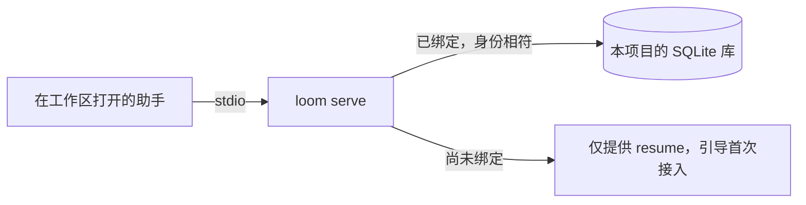

# Loom

[English](README.md) · **简体中文**　|　[MCP 使用手册](doc/MCP/README.zh-CN.md) · [各客户端配置](doc/MCP/clients.zh-CN.md) · [预期欠账与结清条件](docs/DESIGN.md#design-debt)

> 经纬交织：结构是经线，经验是纬线，意图是图案。

Loom 给编码助手提供本地项目记忆和文件依赖证据。一个可执行文件，每个项目一个 SQLite 库；核心功能不需要服务端、账号或网络。

代码能告诉助手项目里有什么，却很少说明当初为什么这样定、改这里会波及谁、上次做到哪。于是每个会话都从重新认识项目开始：反复读同样的文件，重新推出同样的结论，你再把同样的约束讲一遍。这份成本付两遍：花在重复阅读上的词元，和已经做过一次的工作。

Loom 把这部分知识放在项目旁边，按有上限的答案交还：

- **当初为什么这样定**：决策、约束和经验，可绑定到相关文件；源码变了会提示复核。
- **改这里会波及谁**：`impact` / `explain` 给出引用方文件、行号，并区分静态确定与可能。
- **动手前该知道什么**：一次 `context` 取齐约束、双向依赖、文件职责、相关经验和已知缺口。
- **上次做到哪**：未完成任务、下一步和证据位置。
- **哪些是已经说定的**：提议要人确认才生效；确认过的内容每会话投递一次。

它是文件依赖图，不是函数调用图；模型可选、默认关闭；上面这些都能离线完成。接入也可以交给助手：照 `loom guide` 做完，只有需要你拍板的地方才停下来问你。

## 能省下什么

| 省掉的重复工作 | Loom 给出的 | 已记录的实测 |
|---|---|---|
| 靠搜索和通读找“谁用了这个文件” | `impact` / `explain`：引用方文件、行号，以及静态确定还是可能 | 606 个受管文件的真实项目副本上，未确定引用由 3,508 降到 1,858；新增的 1,650 条都标为“可能” |
| 改文件前分开查约束、调用方、职责、旧经验 | 一次 `context`，在同一个字节预算内给齐 | 六个固定任务：每个任务的请求由 4 次减到 1 次，31 项必需依据全部保留 |
| 每个会话重讲约束、重新确认决策 | 已确认意图和置顶经验放进有上限的开场 | 开场 800 字节、`overview` 2,000 字节，每会话只投递一次 |
| 从聊天记录里拼出中断的任务 | `resume`：任务、下一步、证据位置 | 流程已端到端走通；节省量未测 |
| 重新判断一个文件是做什么的 | `note`：人工复核过的职责，绑定源码指纹 | 流程已走通；节省量未测 |

每个答案都有硬上限：开场 800 字节，`overview` 2,000，`context` 默认 1,500、最多 6,144，`recall` / `resume` / `explain` / `impact` 的预览各 1,500。会话付出的量是已知的，不会变成整份文件转储。这些是 UTF-8 字节预算，不是词元数；**直接的词元节省和回答质量提升没有测过**，当前证据只支持上表的请求次数与依据保留结果。见[预期欠账](docs/DESIGN.md#design-debt)与[验收清单](docs/ACCEPTANCE.md)。

**目录**：[安装](#安装) · [交给助手](#交给助手) · [快速上手](#快速上手) · [接入 MCP](#接入-mcp) · [命令行参考](#命令行参考) · [文件依赖查询](#文件依赖查询) · [任务上下文](#改文件前一次取任务上下文) · [意图、职责与任务](#意图职责与任务) · [向量检索与重排](#可选向量检索与重排) · [分享与迁移](#分享与迁移) · [库放在哪](#库放在哪) · [数据、备份与升级](#数据备份与升级) · [常见问题](#常见问题) · [最近更新](#最近更新)

## 安装

```bash
cargo build --release
# 产物：target/release/loom（Windows 上是 loom.exe）
```

Windows 上使用 MSVC x64 工具链时，请在 Visual Studio 的 x64 开发者 PowerShell 中运行构建和测试。若链接器报 `LNK1181` 并提示找不到 `kernel32.lib`，请检查 Windows SDK 是否已安装，以及当前终端是否已加载开发环境。

把产物放进 `PATH` 里的目录，或者在命令和宿主配置里写它的绝对路径；`loom --version` 能输出版本号就可以用。运行时不需要 Rust 工具链、数据库服务、模型或网络。不自己构建的 Windows 用户用打包好的 ZIP，步骤见[离线快速入门](docs/WINDOWS-QUICKSTART.md)。

## 交给助手

装好之后，其余的事可以都让助手做。把下面这段提示词放进用户级的 `AGENTS.md`（ZCode 是 `~/.zcode/AGENTS.md`，其他宿主放进它们各自的全局指令文件），或者只放进某个项目根目录的 `AGENTS.md`。`loom guide agents` 输出的就是这一段：

```markdown
## 项目记忆与结构：Loom

Loom 是本机的项目记忆与源码结构服务，有会话工具和同名的命令行。接入、建索引、搬库、配模型这些操作由你来做，不要让我照着文档逐条敲命令；只有下面写明“先问我”的事才停下来问。

**会话开始**：调 `resume`。

- 首行是项目标识和根目录。根目录不是当前项目，就停下来告诉我。
- 提示还没有接入：在终端运行 `loom guide`（找不到命令时用提示里给出的完整路径），照它的步骤把当前项目接入，做完用两三句话告诉我结果。这一步不用先问我。
- 会话里根本没有 Loom 的工具：告诉我它没有在这个宿主里登记，问我要不要照 `loom guide` 的最后一节登记。

**日常**

- 读或改一个文件之前调 `context`：`target` 写相对项目根的路径，看影响面用 `mode=impact`，看依赖用 `mode=explain`。
- “本次快照的受管范围内没有查到”不等于“项目里没有”。输出里的缺口和“已变化”要如实转述；提示先 `index` 时先调 `index` 再查。改完一批源码也调 `index`。
- 读代码推断不出来的结论（决策原因、坑、修复根因）用 `remember` 存下，并用 `anchors` 绑到文件；写之前先 `recall` 查重。过时的记忆用 `manage` 的 `archive`，不要删除。
- 没做完的工作用 `canvas` 记下目标、下一步和证据位置。

**先问我；我在对话里明确同意之后，由你替我执行**

- 让一条意图生效或失效：你用 `intent` 的 `propose` 登记，我同意后你运行 `loom intent confirm <编号> --yes`；撤销、取代和复核文件职责（`loom note review`）同理。
- 搬库或改默认的库位置：照 `loom guide storage`。
- 启用向量检索与重排：照 `loom guide models`。它会把经验的标题和正文发给模型服务，用本机还是云端由我选。
- 分享、导入和删除记忆。

**密钥**：不要让我把密钥发到对话里，也不要把它写进命令行参数或文件。需要时请我自己在终端运行 `loom config secret embedding`（或 `rerank`），或者告诉你存着密钥的环境变量名。
```

之后在任何项目里开一个会话：

1. 助手调 `resume`。项目还没接入时，Loom 的回答会让它去运行 `loom guide`。
2. 助手照步骤做：确认项目根、`init`、`index`、把 `.loom/` 加进本机的 Git 排除名单，然后汇报项目标识、库的位置和受管文件数。这一步不需要你做任何事，也不改仓库里的文件。
3. 宿主里还没有登记 Loom 时，步骤里也写了怎么登记。这一处改的是宿主配置，助手会先问你。

| 助手自己做 | 先问你，你同意后助手替你执行 |
|---|---|
| 绑定项目、建索引和刷新索引 | 让意图生效、撤销或取代；复核文件职责 |
| 查上下文、存经验、记任务 | 搬库、改默认的库位置 |
| 归档过时的经验 | 启用或停用向量检索与重排，选本机还是云端 |
| | 分享、导入、删除 |

确认权仍然在你：意图要你同意才生效，文件职责要你复核才算数，助手只是替你敲命令。密钥不经过对话。

`loom guide` 的步骤随程序版本更新，提示词本身不用改：

| 命令 | 内容 |
|---|---|
| `loom guide` | 把当前项目接入 |
| `loom guide storage` | 库放在哪、怎么搬 |
| `loom guide models` | 启用向量检索与重排 |
| `loom guide agents` | 上面这段提示词 |

想自己动手，或者想知道助手做了什么，往下看。

## 快速上手

```bash
cd <你的项目>
loom --root . init         # 绑定项目，只做一次；输出项目标识和根目录
loom index                 # 建立结构快照；源码有变动后再执行一次
loom explain src/app.ts    # 这个文件依赖谁
loom impact src/store.ts   # 谁依赖这个文件

# 存一条经验并绑到文件上，再按关键词找回
loom remember GOTCHA '锁冲突时先退避' '同时写入会触发锁冲突；先退避再重试，不要立刻重试。' --anchor src/store.ts
loom recall 锁冲突

# 改文件之前：一次取齐约束、使用方、职责、经验和缺口
loom context src/store.ts --mode impact
```

在这个项目里又确认了一条红线、给 `src/store.ts` 写了职责之后，最后一条命令的实际输出（项目名和根目录已替换）：

```text
项目：demo · 标识=01M89XXK9K8YK99Y1QCJBGXZGH · 根=\\?\D:\work\demo
任务：impact src/store.ts · 深度 1
约束
红线 [01M89XXKCG6HM0YG6QWQMN71EQ] 默认必须离线
结构：快照第 1 代，2026-11-25 18:01 UTC；静态确定 0 条，可能 1 条
可能（1 条）
src/app.ts → src/store.ts · 第 1 行 · 可能 · 第 1 跳
职责与经验
职责（当前）：本地持久化入口；不发网络请求。
经验 [GOTCHA] 锁冲突时先退避 · 2026-11-25 · id=01M89XXKAV970TPMDASVRAARXR · 锚定本文件
  正文：同时写入会触发锁冲突；先退避再重试，不要立刻重试。
缺口
核对：涉及的 2 个文件与快照一致。其余文件未核对，新增的文件查不出。
续查：impact src/store.ts --depth 2；note get src/store.ts；manage get 01M89XXKAV970TPMDASVRAARXR
```

- 绑定之后，在项目的任何子目录里都可以直接运行其余命令：Loom 从当前目录往上找最近的绑定。在项目之外运行时加 `--root <项目根>`。
- 文件参数一律相对**项目根**，在子目录里运行也一样（在 `src/` 里仍然写 `src/app.ts`）；`/` 和 `\` 都认。
- 没有绑定的目录只报错“未找到已绑定项目”，不会顺手建一个空库。
- `loom stats` 的第二行是库文件的位置和大小。想放到别的盘见[库放在哪](#库放在哪)。
- 每个命令都有 `--help`。命令失败时退出码非零，原因写到标准错误。

下一步是[接入 MCP](#接入-mcp)，让助手在会话里直接使用这些能力。

### 项目绑定

首次绑定会在根目录的 `.loom/project.id` 保存项目标识，默认库为 `.loom/loom.db`。`stats` 与会话恢复首行会显示标识和规范化根目录。库放在别处时，位置记在 `.loom/database.path` 里，之后的命令不用再传 `--db`。

- **已有 M0 库**：先关闭旧会话并备份，核对根目录后执行 `loom --root . init --adopt-legacy`。普通查询不会自动升级；无法辨认的库即使指定认领也会拒绝。
- **搬迁项目**：关闭会话，把整个项目连同 `.loom` 移动到新址。在新址执行 `loom --root . init --relocate <原项目标识>`；原根仍存在时按副本处理，不会改绑。
- **从其他目录启动助手**：给服务传入正确的 `--root`，而不是靠当前目录猜测项目。没有显式根时只查找最近的项目标识或旧库，不找到就停止。

## 接入 MCP

按宿主复制配置，见[各客户端配置](doc/MCP/clients.zh-CN.md)；工具参数、首次绑定流程和问题诊断见[MCP 使用手册](doc/MCP/README.zh-CN.md)。

`loom serve` 是 stdio 方式的 MCP 服务：由宿主（ZCode、Claude Code、Codex 等）启动，不监听端口，一个进程只服务一个项目。默认不配置或调用模型，日常记忆和结构查询可以离线运行。它也不长期占着库：每次工具调用现开现关，会话空闲时可以搬库、备份。

### 第一步：在宿主里登记

所有宿主要的都是同一组信息：**命令**是 `loom` 可执行文件（不在 `PATH` 里就写绝对路径），**参数**是 `serve`。

**ZCode**：用户级写在 `~/.zcode/cli/config.json`，项目级写在 `<项目>/.zcode/config.json`，键是 `mcp.servers`。只把 `loom` 这一条并进已有的内容，不要覆盖整份文件。

```json
{
  "mcp": {
    "servers": {
      "loom": {
        "type": "stdio",
        "command": "C:/Users/<用户名>/.local/bin/loom.exe",
        "args": ["serve"],
        "enabled": true
      }
    }
  }
}
```

**Claude Code**：用命令登记，或者手写项目根的 `.mcp.json`。

```bash
claude mcp add loom -- loom serve                    # 只在当前项目、只对你自己（默认范围）
claude mcp add --scope user loom -- loom serve       # 你的所有项目
claude mcp add --scope project loom -- loom serve    # 写进项目根的 .mcp.json，可随仓库共享
```

```json
{
  "mcpServers": {
    "loom": { "command": "loom", "args": ["serve"] }
  }
}
```

**Codex**：`codex mcp add loom -- loom serve`，或者在用户配置 `~/.codex/config.toml` 里写（设过 `CODEX_HOME` 时用 `$CODEX_HOME/config.toml`；项目级是受信任项目里的 `.codex/config.toml`）：

```toml
[mcp_servers.loom]
command = "loom"
args = ["serve"]
```

**其他宿主**：支持 stdio 的 MCP 客户端都用同样的命令和参数，多数接受上面 `mcpServers` 那种写法。

本机 ZCode 已实际调用 Loom 工具，Claude Code 的 `claude mcp get loom` 显示已连接，Codex 已用自己的 CLI 登记并查到配置。三者的全新项目端到端接入及自动刷新工具列表尚未逐一验收。宿主版本或信任策略不同，项目级服务可能需要先确认。

### 第二步：确认接通

1. 新开一个会话，或在宿主的 MCP 设置里重连这个服务。
2. 让助手调用 `resume`。
   - **项目已经绑定**：首行是 `项目：<名称> · 标识=<项目标识> · 根=<根目录>`，工具列表里有 17 个工具，名字见[会话工具与参数](#会话工具与参数)。根目录不是当前项目，说明服务连到了别的库，按下一小节改配置。
   - **项目还没绑定**：服务照样启动，但只列出 `resume` 一个工具。它的回答是“这个项目还没有接入 Loom。运行 `loom guide`，按其中的步骤由你完成接入”，并附上这个服务自己的程序路径（`loom` 不在 `PATH` 里时用它），不创建任何东西。助手（或你）在命令行执行过 `init` 之后，同一个服务进程下一次调用就能用，并通知宿主工具列表变了；宿主没有自动刷新时，重连一次服务或新开会话。

没有连上时见[常见问题](#常见问题)。手动运行 `loom serve` 后没有提示符是正常的，它在等标准输入。

### 一份配置用于多个项目

`serve` 不带 `--root` 时，从宿主启动它的那个工作目录往上找最近的绑定。



尚未绑定不会自动建库；如果是原库丢失或身份不符，应停下核对，而不是重新初始化。

| 写法 | 效果 | 什么时候用 |
|---|---|---|
| 用户级配置，参数 `["serve"]` | 每个项目的会话各连各的库 | 宿主在项目目录里启动服务，ZCode 实测如此 |
| 项目级配置，参数 `["--root", "<项目根的绝对路径>", "serve"]` | 固定连这一个项目 | 宿主的启动目录不是项目目录，或只想给个别项目启用 |
| 用户级配置里写死 `--root <某个项目>` | **所有项目的会话都读写那一个项目的库** | 不要这样写 |

用了第一种写法之后，没有绑定过的项目里这个服务照样能连上，只是只有 `resume` 一个工具，直到那个项目执行过 `init`。库放在别处的项目不用额外传参数，位置记在项目的 `.loom/database.path` 里。

### 会话工具与参数

加粗的参数必填，其余可省略。

| 工具 | 参数 | 作用 |
|---|---|---|
| `resume` | `hours`（回看多少小时，默认 24） | 恢复现场：先核对项目身份，再列未完成任务、下一步和证据位置，最后是近期记忆标题与需复核项 |
| `overview` | 无 | 开工概览：经人确认的目标、红线和置顶经验；本会话已经给过时只回快照编号 |
| `refresh` | 无 | 按当前内容重选概览并给新快照；不重扫源码，不复核职责 |
| `context` | **`target`**、**`mode`**（`explain` / `impact`）、`question`、`depth`（1–3，默认 1）、`budget`（1–6144，默认 1500） | 读或改一个文件前，一次取齐约束、依赖或使用方、职责、相关经验和缺口；只读 |
| `index` | 无 | 刷新结构快照，报告解析、未变和未覆盖数量 |
| `explain` | **`target`**、`depth`（1–3，默认 1） | 这个文件依赖谁，附公开符号、行号和未确定的引用 |
| `impact` | **`target`**、`depth`（1–3，默认 1） | 谁依赖这个文件；不确定的候选不混入确定关系 |
| `remember` | **`type`**、**`title`**（最多 120 字符）、**`body`**（8 到 2000 字符）、`anchors`、`tags`、`importance`（1–5，默认 2）、`force` | 保存一条记忆。`anchors` 写 `src/a.rs` 或 `src/a.rs#Foo::bar`。完全重复会合并；标题相似时返回候选，确认要新建再带 `force=true`；凭据自动脱敏 |
| `recall` | `query`、`types`、`top_k`（默认 8，最多 50）、`full`、`include_archived` | 关键词检索，空格分隔，中英文都可；`query` 为空时给最近的记忆。正文默认截到 240 字符，`full=true` 给全文。项目启用了向量检索时是关键词加向量，首行说明这次是怎么查的 |
| `manage` | **`action`**（`get` / `archive` / `activate` / `supersede` / `delete` / `stats`）、`ids`、`by`、`confirm` | 按编号取全文和锚点，或改变状态。`supersede` 用 `ids=[旧]`、`by=新`；`delete` 要 `confirm=true` 且不可恢复，过时的内容优先 `archive` |
| `intent` | **`action`**（`list` / `get` / `propose`）、`id`、`kind`（`goal` / `constraint` / `non_goal` / `decision`）、`title`、`body` | 查项目意图或登记提议。提议不生效；确认、撤销和取代只经 CLI，须由用户明确决定，可以授权助手代为执行 |
| `note` | **`path`**、`action`（`get` / `set`，默认 `get`）、`expected_sha`、`role` | 查看或写入文件的人工职责。`set` 要给出刚核对过的完整 SHA-256；不能代人复核 |
| `canvas` | **`action`**（`list` / `get` / `open` / `update` / `close`）、`id`、`goal`、`next`、`evidence` | 跨会话的未完成任务。`open` 要 `goal`、`next`、`evidence`；`update` 要 `id`、`next`、`evidence`；`get`、`close` 要 `id` |
| `evidence` | **`query`** | 只读证据包：直接命中、已声明的支持或冲突、复核提示和缺口；不推断关系 |
| `semantic` | **`query`** | 只在人工授权过的记忆里跨措辞查找；没有模型时在同一范围退回关键词 |
| `rerank` | **`query`** | 对关键词候选重排；模型未启用时保持关键词顺序 |
| `extract` | **`text`** | 从本次给出的文本提炼待审建议；不写库 |

记忆类型（`type`、`types`）是 `DECISION`、`BUGFIX`、`GOTCHA`、`ERROR_PATTERN`、`CONFIG`、`FEATURE`、`MILESTONE`、`PROGRESS`、`CODE_PATTERN`、`SYNTHESIS` 之一。`refresh` 和 `resume` 只在会话中提供，其余工具都有同名命令。

### 建议的调用顺序

1. **会话开始**：用 `resume` 核对项目身份或恢复中断任务；提示还没接入时照 `loom guide` 接入。如果没有收到自动开场快照，新会话显式调一次 `overview` 取得已确认的目标与红线。`resume` 不代替 `overview`。
2. **读或改一个文件之前**：`context`。看改动会波及谁用 `mode=impact`，看它依赖谁用 `mode=explain`。
3. **输出提示“已变化”或“先执行 loom index 再采信”**：先 `index`，再查一次。
4. **改完一批源码**：`index`。
5. **得到读代码推断不出来的结论**（决策原因、坑、修复根因）：先 `recall` 查重，再 `remember`，用 `anchors` 绑到相关文件。
6. **工作跨会话**：`canvas` 的 `open` 记目标、下一步和证据位置，推进时 `update`，做完 `close`。
7. **想让一条约束长期生效**：`intent` 的 `propose`，然后请用户确认。
8. **采信带 `⚠code_drift`、`⚠stale` 标记的记忆之前**：先核对代码。前者表示锚定的文件改过，后者表示时间久了。

把这些约定交给助手的提示词见[交给助手](#交给助手)。

### 不经会话工具提供的操作

下面这些只有命令行，会话工具做不了，多数要加 `--yes`。它们改的是“什么算数”或“数据去哪”，要你明确同意；同意之后可以由助手替你在命令行执行：

- 绑定与迁入：`init`、`import`。绑定只在本机建一个小目录，[提示词](#交给助手)里已经授权助手直接做。
- 让意图生效或失效：`intent confirm`、`intent revoke`、`intent replace`；置顶经验：`intent pin`、`intent unpin`。
- 复核文件职责：`note review`。
- 声明两条记忆之间的支持或冲突：`evidence link`。
- 库的位置：`db move`、`config set storage.data_dir`。
- 模型：`config set`、`config secret`、`model test`、`model pull`、`semantic enable`、`semantic disable`、`semantic index`；逐条授权标题的 `semantic allow`、`semantic deny`。
- 分享：`share preview`、`share export`、`share import`。

### 开场与预算

| 输出 | 整份上限（UTF-8 字节） |
|---|---:|
| 握手时的自动开场 | 800 |
| `overview`、`refresh` | 2,000 |
| `recall`、`resume`、`explain`、`impact` 的预览 | 各 1,500 |
| `context` | 默认 1,500，用 `budget` 最多调到 6,144 |

- MCP 会话以单个 stdio 连接为边界。只有握手声明 `capabilities.experimental["loom/overview"].textBudget = "utf8-byte-upper-bound"` 的宿主才会在初始化的 `instructions` 收到开场；其余宿主不自动注入知识，可主动调 `overview`。开场和主动概览分别把**整段**限制在 800 / 2,000 个 UTF-8 字节（含编号与省略提示）。只有满足该约定才是词元数的保守上界，非通用分词器；正文不会在同一会话反复发送。要核对已撤销的约束，用 `intent get` 或 `refresh`，不要相信旧上下文会自行消失。
- 默认会话中的 `recall`、`resume`、`explain`、`impact` 预览各限整份 1,500 字节；`context` 默认同样为 1,500 字节，可显式调整。按编号显式取全文与默认预览分开。近似项只在正文、类型、状态、来源和锚点等一致、标题仅有安全的排版差异时折叠；保留原编号，绝不删记忆。
- 预览放不下时整行省略并给出省略条数，不截半行。要看全部证据，在命令行给 `explain`、`impact`、`context` 加 `--json`，或者缩小目标、降低深度。

## 命令行参考

全局选项：`--root <目录>` 指定项目根，不给时从当前目录往上找最近的绑定，`init` 必须显式给；`--db <文件>` 临时指定库文件，优先于项目记住的位置。

**项目与服务**

| 命令 | 作用 |
|---|---|
| `loom guide [setup\|storage\|models\|agents]` | 输出写给助手的操作步骤；不带主题时是“把当前项目接入”。不需要已绑定的项目 |
| `loom --root <目录> init [--db <文件>]` | 绑定项目并建库；重复执行返回同一标识。`--db` 把库建在指定位置并记住，对已绑定的项目则是重新关联挪过的库。`--adopt-legacy` 认领旧版无身份库，`--relocate <原项目标识>` 确认项目已搬迁 |
| `loom stats` | 项目标识、根目录，库文件的位置和大小，以及按状态和类型统计的记忆条数 |
| `loom db move <目标> [--yes]` | 把项目库搬到目标目录或文件；不带 `--yes` 只预演 |
| `loom serve` | 以 MCP stdio 服务运行，由宿主启动；项目没绑定时也能启动 |

**本机配置**（不需要已绑定的项目）

| 命令 | 作用 |
|---|---|
| `loom config path` | 用户配置文件的位置，以及它存不存在 |
| `loom config list` | 全部键的当前值；每个模型服务是本机还是云端、密钥来自哪里 |
| `loom config get <键>` | 输出一个键的值；没有设置时退出码非零 |
| `loom config set <键> <值>` | 校验后写入；文件不存在时创建，手写的注释保留 |
| `loom config unset <键>` | 删除一个键 |
| `loom config secret <embedding\|rerank> [--from-env <变量名>] [--clear]` | 把密钥存进凭据文件。不接受写在命令行上的密钥：从环境变量、管道或不回显的终端输入里取 |
| `loom model test` | 实测已配置的向量和重排接口，报告维度、用时和失败原因 |
| `loom model pull` | 向量模型不在本机时让 Ollama 下载，显示进度 |

**结构与任务上下文**

| 命令 | 作用 |
|---|---|
| `loom index [--json]` | 刷新结构快照；输出代次、受管、解析、未变、未覆盖数量和这次用的范围 |
| `loom explain <文件> [--depth <1-3>] [--json]` | 这个文件依赖谁 |
| `loom impact <文件> [--depth <1-3>] [--json]` | 谁依赖这个文件 |
| `loom context <文件> --mode <explain\|impact> [--question <关键词>] [--depth <1-3>] [--budget <1-6144>] [--json]` | 一次取齐约束、结构、职责、经验和缺口 |

**经验**

| 命令 | 作用 |
|---|---|
| `loom remember <类型> <标题> <正文> [--anchor <路径[#符号]>]` | 保存并输出编号；标题与已有记忆相似时拒绝写入，并给出候选编号 |
| `loom recall [关键词…] [-k <条数>]` | 关键词检索，默认 8 条；不给关键词时列最近的记忆。项目启用了向量检索时是关键词加向量，首行说明这次是怎么查的 |
| `loom manage get <编号>…` | 全文、状态、重要度、漂移、标签和锚点 |
| `loom manage archive <编号>…` | 归档：默认检索不再出现 |
| `loom manage activate <编号>…` | 把已归档或已被取代的记忆恢复为有效 |
| `loom manage supersede <旧编号>… --by <新编号>` | 用新记忆取代旧记忆；旧条目保留，标为已取代 |
| `loom manage delete <编号>… --yes` | 物理删除，不可恢复 |
| `loom import <wiki 目录> [--apply]` | 迁入旧的文本记忆页；不加 `--apply` 只预演并输出统计 |

命令行的 `remember` 一次只能绑一个锚点，也不能设标签、重要度或强制新建；这些要通过会话工具 `remember`。`manage` 给出的编号有一个不存在就整体拒绝。

**意图与概览**

| 命令 | 作用 |
|---|---|
| `loom intent propose <goal\|constraint\|non_goal\|decision> <标题> <正文>` | 登记提议并输出编号；提议本身不生效 |
| `loom intent list` | 列出意图的编号、标题和状态 |
| `loom intent get <编号>` | 正文和变更记录 |
| `loom intent confirm <编号> --yes` | 确认一项待审提议 |
| `loom intent revoke <编号> --yes` | 撤销当前有效的意图 |
| `loom intent replace <旧编号> <新提议编号> --yes` | 用待审的新意图原子地取代当前有效意图 |
| `loom intent pin <记忆编号> --yes` | 把有效经验置顶到概览 |
| `loom intent unpin <记忆编号> --yes` | 取消置顶，不删除经验 |
| `loom overview` | 目标、红线和置顶经验；每次都按当前内容重新选取 |

**文件职责**

| 命令 | 作用 |
|---|---|
| `loom note get <路径>` | 职责、状态、当前指纹和人工基线 |
| `loom note set <路径> <指纹> <职责>` | 以刚核对过的指纹写入职责 |
| `loom note review <路径> <新指纹> --yes` | 文件改过之后，确认原职责仍适用 |

**任务与证据**

| 命令 | 作用 |
|---|---|
| `loom canvas open <目标> <下一步> <证据位置>` | 新建任务并输出编号 |
| `loom canvas list` | 未关闭任务的当前步骤 |
| `loom canvas get <编号>` | 任务及历史步骤 |
| `loom canvas update <编号> <下一步> <证据位置>` | 追加下一步及证据位置 |
| `loom canvas close <编号>` | 关闭任务，保留历史 |
| `loom evidence pack <问题>` | 直接记录、已声明的关系、复核提示和缺口 |
| `loom evidence link <来源编号> <目标编号> <supports\|conflicts> --yes` | 声明前者支持或反对后者 |

**向量检索、小范围增强与分享**

| 命令 | 作用 |
|---|---|
| `loom semantic enable [--yes]` | 对这个项目启用向量检索。不带 `--yes` 只预演：发到哪、发什么、有多少条 |
| `loom semantic status` | 是否启用、模型地址、密钥来源、已建和待建的向量数 |
| `loom semantic index [--limit <条数>]` | 给还没有向量的经验建向量，可重复执行；顺手清理已归档经验的向量 |
| `loom semantic disable --yes [--purge]` | 停用；`--purge` 同时删除这个项目的向量 |
| `loom rerank <问题>` | 对关键词候选重排 |
| `loom semantic find <问题>` | 在授权过的记忆里跨措辞查找 |
| `loom semantic allow <编号> --yes` | 授权一条有效记忆参与语义查找，最多 12 条 |
| `loom semantic deny <编号> --yes` | 撤回授权 |
| `loom semantic list` | 列出已授权的记忆；不调用模型 |
| `loom extract <文本>` | 从给出的文本提炼待审建议；不写库 |
| `loom share preview [--intent <编号>]… [--memory <编号>]…` | 查看将要分享的确切内容和摘要 |
| `loom share export <新文件> [--intent <编号>]… [--memory <编号>]… --reviewed-sha <摘要> --yes` | 复核后写出一个新文件 |
| `loom share import <文件> [--reviewed-sha <摘要> --yes]` | 默认只预览；给出摘要和 `--yes` 才接收 |

## 文件依赖查询

首次使用或源码有变动时，显式执行 `loom index`。然后对项目内的相对路径运行 `loom explain <文件>`（查它引用谁）或 `loom impact <文件>`（查谁引用它）。默认只查一跳，`--depth 2` 或 `--depth 3` 可以展开；三个命令都支持 `--json`。查询不会隐式刷新，更不会创建空库。升级 Loom 后若查询提示“结构快照版本不匹配”，重新执行一次 `loom index` 即可，记忆不受影响。

### 规则

- 目前识别 Rust 文件模块与部分本地引用、JS/TS（含 JSX/TSX）的本地静态导入及转出、Vue 单文件组件 `<script>` 里的导入、Python 的包导入、Go 的包导入和包级名字、Java 的导入和类型名、C/C++ 的 `#include`。行号始终在使用方；“可能”和“静态确定”分开。多个候选不会任选其一，动态加载、别名配置和运行时调用链不作为确定依赖。
- JS/TS 和 Vue 的相对静态导入，只有写全了文件名（如 `./store.ts`）才报“静态确定”。省略扩展名（`./store`）或指向目录的，即使只对上一个文件也报“可能”。“可能”说的是证据的确定程度，不代表这条关系有疑点。
- 有几类目标只按约定成立，一律报“可能”：TypeScript 文件里写 `./x.js`（或 `.jsx`、`.mjs`、`.cjs`），而项目里只有对应的 `x.ts`、`x.tsx`、`x.mts` 或 `x.cts`；省略扩展名的相对导入找不到脚本文件时，改找同名的 `.vue`，TypeScript 文件再找 `.d.ts`；Python 绝对导入的包放在 `src/` 下（使用方自己所在的 `src/`，或它在 `src` 之外的某级上级目录里的 `src/`），导入至少两段时也可以位于与首段同名的祖先目录里。写在函数或分支里的 `import` 同样给出候选，但不一定执行，即使是相对导入也只报“可能”。JS/TS 和 Vue 里说明符是字面量的 `import('…')`、`require('…')` 按同样的规则给候选，写全了文件名也只报“可能”；说明符是表达式的仍是未确定。Python 的绝对导入还会到“包根”去找，也就是从使用方所在目录往上、越过所有带 `__init__.py` 的目录后停下的那一级：脚本目录里的 `import helper` 能连到同目录的 `helper.py`，包里的 `import openai` 不会连到同目录的 `openai.py`。书写的文件与源码文件并存时算多个候选。Loom 不读打包配置，也不按包名把导入归为外部，所以 JS/TS 和 Python 的标准库和第三方导入仍显示为未确定。
- JS/TS 和 Vue 的裸名导入（如 `@/utils/request`）先按 `tsconfig.json` 或 `jsconfig.json` 的 `paths` 改写：用离使用方最近的那份配置，跟着 `extends` 和 `references` 找，认 `baseUrl` 和 `${configDir}`；改写后的路径与相对导入一样补扩展名和 `index`。命中只报“可能”，因为打包器实际用的别名写在它自己的配置里，两边通常一致但没有保证。别名对上了却找不到文件时，报“受管文件中没有候选”。任何一份配置有变化，下一次 `loom index` 重新解析全部 JS、TS 和 Vue 文件。
- Go 和 Java 的引用不写文件路径，Loom 按名字去找声明它的文件。Go 读各级 `go.mod` 的模块路径，把 `包名.导出名` 和同包的包级名字落到文件上；Java 按“包 + 顶层类型”找，只看类型名，不跟踪经变量访问的成员。只对上一处声明，并且使用方和目标在同一个 Go 模块或同一个 Java 源码根里，才算“静态确定”，否则只报“可能”或多个候选；Go 里受构建约束的文件（文件名带系统或架构后缀、`//go:build`、cgo）、Java 的同包类型和 `import p.*` 带来的类型也只报“可能”。不在项目任何模块之下的 Go 导入和 `java.` 开头的导入归为外部；只是提到、项目里又没有声明的名字不算未确定。同一对文件之间按名字的多处使用，查询只列行号最小的一处。
- C/C++ 只读 `#include`。引号形式先找使用方旁边的文件，找到且不在条件编译里算“静态确定”；找不到时把项目里路径以所写内容结尾的头文件当候选，只报“可能”，因为 Loom 读不到编译参数里的包含路径。`<stdio.h>` 这样只有文件名的尖括号包含不猜。Vue 单文件组件只读 `<script>` 和 `<script setup>`，模板里用到的组件不解析。
- 用 Git 管理的项目，一个文件纳不纳入以 Git 的忽略规则为准：仓库的 `info/exclude` 和各级 `.gitignore`。没被忽略的源码放在 `build`、`vendor`、`credentials` 或以 `.` 开头的目录里也照常索引。“用 Git 管理”指项目根或它的上级目录里有 `.git`，或者根目录有 `.gitignore`。`node_modules`、虚拟环境、带缓存标记的目录、嵌套项目和目录链接始终不纳入，`*.min.js` 这类生成文件只登记。不在 Git 里的项目按内置名单跳过隐藏文件、生成物和常见私密目录。`loom index` 的输出会说明这次用的是哪一种范围。
- 其他私密源码路径请写进根目录的 `.loom/ignore`，它只能追加排除。索引只存路径、符号名、导入写法和行号，不存源码里的值；名字本身像凭据的文件不纳入，符号名和写法只存掩码。超过 1 MiB、读不到、编码不支持或语法错误会标记为未覆盖，不能把它们当成“没有影响”。
- 受管范围每次都会枚举，小文件也会重新取指纹；“增量”指未变的文件不重新解析。删除引用或改名时，旧关系会撤掉。无法确定完整扫描范围时不发布半成品，查询继续读上一次成功的快照。

### 已测结果

复跑隔离基准：构建优化版后，在本机运行 `./scripts/measure-structure.ps1`。脚本生成并清理专用的五万行样本，分别报告全量、无改动和单文件改动的时间；不会访问开发库。

本机记录（2026-11-21，64 位，12 个逻辑处理器）：500 个文件、50,000 行合成源码，三轮全量耗时中位数 1.038 秒，索引进程观测峰值工作集最高 9.90 MiB。无改动中位数 0.143 秒，解析 0 个文件；改一处引用中位数 0.303 秒，解析 1 个文件、499 个文件不重解析，旧边消失。30 对预设关系均已正反向核对行号。这是结构固定的合成样本，不是任意仓库的解析准确率或内存上限。2026-11-23 的五万行复测，以及在 `oh-memos` 副本上测得的索引耗时和服务空闲内存，见[本地资源复测](docs/ACCEPTANCE.md#本地资源复测)。

冻结 M1 的 25 个真实源码文件作前后对照。原始引用都是 146 处：发布版确认 18、待定 128；后续版本确认 29、待定 117（补上 12 处、有 1 处旧结论被撤回）。29 处逐条核对了正反方向和使用方行号。只移除中间模块声明，使用方和目标内容不变，下一次索引也会撤边。包名看似来自标准库或外部依赖，都没有因此直接归为外部；这不是项目整体的准确率。

在 `oh-memos` 提交 `810627e` 的副本上（606 个受管文件、3,798 处引用），上述规则把未确定的引用由 3,508 处降到 1,858 处。新增的 1,650 条关系都是“可能”，原有的 145 条确定关系和 18 条可能关系逐条未变，库文件由 1.21 MiB 增至 2.31 MiB。剩下的未确定项主要是标准库和第三方导入，另有约 125 处本地引用还连不上。依据、已知限制和资源对比见[结构修订 4 复测](docs/ACCEPTANCE.md#结构修订-4-复测)和[结构修订 5 复测](docs/ACCEPTANCE.md#结构修订-5-复测)。

Go、Java、C/C++ 和 Vue 的规则在七个公开项目的固定版本上与独立的参照对照过：x/tools、grpc、JDK 17 的十个模块、libuv、leveldb、vitepress 和 vue-element-admin。在各自的口径内，索引连上的关系与参照不符的只有 libuv 的 5 条（共 717 条），参照里的关系连上了约 96% 到 100%。原有四种语言在三份样本上的结论逐条未变。这些数字只对所列样本和口径成立；对照方法、已知限制和资源见[结构修订 6 复测](docs/ACCEPTANCE.md#结构修订-6-复测)。

别名导入在 vitepress 和 vue-element-admin 上与按同样配置解析的参照对照过，参照又与 TypeScript 7.0.2 自己的解析逐条核对过。参照能落到项目文件的别名静态导入分别有 111 条和 115 条，索引连上 109 条和 115 条，没有一条与参照不符；vitepress 漏的 2 条写在 `declare module` 块里。vue-element-admin 按全部能落到项目文件的导入算，由约 31% 升到约 73%，剩下的是动态 `import()` 和 `require()`。三份回归样本和另外五个公开样本的结论逐条未变。见[结构修订 7 复测](docs/ACCEPTANCE.md#结构修订-7-复测)。

范围、动态导入和 Python 包根在四个带 `.git` 的样本上各与一个独立的参照对照过：vue-element-admin、vitepress、grpc 和 oh-memos。受管文件与 `git ls-files` 里受支持的源码文件一个不多、一个不少，上一版分别少 5、17、85 和 13 个。参照里说明符是字面量的动态导入有 81 条和 4 条落在受管文件上，全部连对。oh-memos 里参照落在本地的 1,524 处 Python 绝对导入全部连上，其中 81 处是这次新连的；包目录里与第三方库同名的 8 处没有一处连错。把范围固定成与上一版相同后，grpc 和 Loom 自身三个版本的引用、候选和 4,584 次查询输出逐条未变。见[结构修订 8 复测](docs/ACCEPTANCE.md#结构修订-8-复测)。

## 改文件前：一次取任务上下文

```bash
loom context crates/loom-core/src/search.rs --mode impact
loom context crates/loom-core/src/search.rs --mode explain --question '排序 漂移' --budget 3000
# --json 返回同一文本、分区、省略计数和完整结构证据
```

`mode` 必填：`explain` 查依赖，`impact` 查使用方；`depth` 默认 1，最多 3。输出依次是身份与有效约束、结构、职责与经验、缺口。默认上限 **1,500 个 UTF-8 字节**，最大 6,144，不是词元；必要提示也放不下时拒绝并给出最低预算，不截断半条证据。归档经验和未确认提议不参与，源码变化后的历史职责保留并标为需复核。

经验先按文件锚点找，再按 `question` 补查；没给时按带扩展名的文件名补查。`question` 是空格分隔的关键词，不带空格的整句算一个词，不自动分词或调用模型。每条经验注明“锚定本文件”“关键词命中”或“提到本文件名”，不能把文字命中当作已核实的文件关联。

`context` 只读，不保存问题，不消耗 `overview` 的会话去重状态，也不代替显式 `index`。结构结论同时说明快照代次、缺口和现场核对结果：最多核对 32 个涉及文件，不扫描全项目，新增文件可能查不出。“快照受管范围内没查到”不等于“当前项目不存在”。旧版修订 8 快照仍可读；再执行一次 `loom index` 才补齐覆盖明细。固定评测与资源对照见 [eval](eval/README.md)。

## 意图、职责与任务

让助手知道什么，由人说了算：下面带 `--yes` 的命令要你明确同意，同意之后可以自己敲，也可以让助手替你敲。命令行的 `overview` 每次都按当前内容重新选取；未完成任务用 `canvas list` 查看，统计用 `stats`。

- `loom intent propose constraint '默认必须离线' '不能要求联网才能保存经验。'` 返回提议编号；只有执行过 `loom intent confirm <编号> --yes`，它才有资格出现在开场。用 `loom intent replace <旧编号> <新提议编号> --yes` 原子取代旧结论。高分不等于置顶；`loom intent pin <记忆编号> --yes` 才会置顶经验。
- 对已索引文件先 `loom note get <相对路径>`；核对输出中的当前指纹，再用 `loom note set <相对路径> <指纹> <职责>`。读取不更新基线；改文件后是“需复核”，更新索引并确认原职责仍适用时才执行 `loom note review <相对路径> <新指纹> --yes`。删除文件不删除历史职责。
- `loom canvas open <目标> <下一步> <证据位置>` 创建任务。新会话调用会话工具 `resume`（命令行用 `loom canvas list` 查看未完成任务），不要把最近更新的记忆当作待办。`loom evidence link <来源编号> <目标编号> supports --yes` 表示前者支持后者，反对用 `conflicts`；`loom evidence pack <问题>` 只依据实际记录，不从相似措辞猜矛盾。
- `loom manage get <编号>` 取记忆全文；`archive`、`activate` 和 `supersede <旧编号> --by <新编号>` 改变状态；`delete` 不可恢复，须加 `--yes`。

## 可选：向量检索与重排

默认关闭。不配置、不启用时，写入、关键词检索、任务恢复和证据查询都照常离线可用，也不发任何请求。

启用后，`recall`（命令行和会话工具）变成“关键词 + 向量”的混合检索，换一种说法也有机会找回经验。配了重排模型时，再对前 24 条重排一次。向量失败退到关键词，只有重排失败则保留融合排序，原因写在首行。`context` 不调用模型。

**先知道发送范围**：查询词和有效经验的标题、正文会经凭据脱敏后发给选定的模型服务；每条经验最多 2,000 个字符。Loom 不额外附带编号、锚点、项目或文件元数据，也不读取源码文件发送。但自由文本中写过的内部路径、项目名、代码片段或其他业务信息仍可能发出；不能接受时保持关闭或用本机服务。向量保存在项目库里，每条约“维度 × 4”字节，1024 维是 4 KiB。

### 1. 配置模型（每台机器一次）

模型配置是用户级的，存在 `loom config path` 给出的文件里（Windows 上是 `%APPDATA%\loom\config.toml`，其他系统是 `~/.config/loom/config.toml`，可用环境变量 `LOOM_CONFIG` 改到别处）。它不进项目库，也不随项目分享。向量和重排都是“地址 + 模型名”：地址是 OpenAI 兼容接口的根，请求发到 `<地址>/embeddings` 和 `<地址>/rerank`。

本机，用 Ollama：

```bash
loom config set embedding.base_url http://127.0.0.1:11434/v1
loom config set embedding.model bge-m3
loom model pull     # 模型不在本机时让 Ollama 下载并显示进度；bge-m3 约 1.2 GB
loom model test     # 实测接口，报告维度和用时
```

云端，以硅基流动为例：

```bash
loom config set embedding.base_url https://api.siliconflow.cn/v1
loom config set embedding.model BAAI/bge-m3
loom config set embedding.api_key_env SILICONFLOW_API_KEY   # 密钥从这个环境变量取
loom model test
```

不想用环境变量时，运行 `loom config secret embedding`，按提示输入密钥（不回显），它存进配置文件旁边的 `credentials.toml`。

重排模型可选。不配时按关键词与向量的融合顺序给结果：

```bash
loom config set rerank.base_url https://api.siliconflow.cn/v1
loom config set rerank.model BAAI/bge-reranker-v2-m3
loom config set rerank.api_key_env SILICONFLOW_API_KEY
```

| 键 | 含义 |
|---|---|
| `embedding.base_url`、`rerank.base_url` | 接口地址。云端必须是 `https`；`http` 只用于本机回环地址 |
| `embedding.model`、`rerank.model` | 模型名 |
| `embedding.api_key_env`、`rerank.api_key_env` | 密钥所在的环境变量名。没有设、或变量是空的，就用凭据文件里的；本机服务一般不需要密钥 |
| `embedding.dimensions` | 请求里带的维度，1 到 4096。模型不支持调维度时不要设 |
| `embedding.batch` | 一次请求最多多少条，默认 10，最多 64 |
| `embedding.timeout_ms`、`rerank.timeout_ms` | 单次请求的截止时间，默认 8000 毫秒 |
| `storage.data_dir` | 与模型无关：新项目的库建在哪，见[库放在哪](#库放在哪) |

`loom config list` 列出全部键的当前值，并说明每个服务是本机还是云端、密钥来自哪里。任何输出都不显示密钥本身。`loom config secret` 不接受写在命令行上的密钥。

**本机重排**：Ollama 目前没有重排接口，`loom model pull` 只下载向量模型。要在本机重排，用 llama.cpp 的 `llama-server` 另起一个服务，例如 `llama-server -hf <重排模型的 GGUF 仓库> --reranking --port 8081`（首次启动会下载模型），再把 `rerank.base_url` 设成 `http://127.0.0.1:8081/v1`。它的接口形状与硅基流动、Jina、Cohere 相同。Hugging Face TEI 和阿里云百炼的重排接口形状不同，这一版不支持。

### 2. 对项目启用（每个项目一次）

下面是当前程序的输出。预演里“不发送”的清单指**不额外附带字段或读入源码文件**，并非正文内容过滤保证；自由文本的例外见本节开头的说明。

```text
$ loom semantic enable
[预演] 向量：bge-m3 @ http://127.0.0.1:11434（本机），密钥来源：无
重排：未配置
发送：脱敏查询词、有效经验的脱敏标题和正文（每条最多 2000 字符；重排最多 24 条）。
不发送：记忆编号、锚点、文件路径、标签、项目名、根目录、项目标识、源码、意图、文件职责、任务画布。
有效经验 2 条；向量空间：维度未配置，按 1024 维估算约 8.0 KiB。
确认后执行 loom semantic enable --yes

$ loom semantic enable --yes
已授权当前模型地址。
新建 2，更新 0，跳过（敏感）0，失败 0，清理 0

$ loom semantic status
已启用（2026-11-25）
向量：bge-m3 @ http://127.0.0.1:11434（本机），密钥来源：无
重排：未配置
有效经验 2，已有当前向量 2，待建或过期 0，因敏感内容跳过 0
向量同意地址：http://127.0.0.1:11434；一致
重排同意地址：无；一致
```

同意是绑在模型地址上的。之后把配置换到另一个主机，这个项目就不再使用模型，`recall` 和 `status` 会提示重新执行 `loom semantic enable`。只换模型名不用重新同意，但旧向量全部要重建。

### 3. 使用

```text
$ loom recall 中断回到 做完事情
检索方式：关键词 + 向量
[1] 0.800 DECISION 任务画布恢复现场 · 2026-11-25 · Fresh/Clean · id=01M8AC8XAT2V1AYCAMMJ00HRKB
[2] 0.320 GOTCHA 锁冲突时先退避 · 2026-11-25 · Fresh/Clean · id=01M8AC8X9TTGYGAKYMNF3RJNAT
```

这两个词在任何标题和正文里都找不到，没启用时的结果是“没有找到相关记忆”。

| 第一行 | 含义 |
|---|---|
| `检索方式：关键词 + 向量 + 重排` | 三步都做了 |
| `检索方式：关键词 + 向量` | 没有配置重排模型 |
| `检索方式：关键词 + 向量（重排不可用：<原因>）` | 重排失败，按融合顺序给 |
| `检索方式：仅关键词（向量不可用：<原因>）` | 向量失败，结果与没启用时相同 |

原因是这几类之一：未配置、配置不完整或无效、地址不合规、连接失败、超时、鉴权失败、模型不存在、服务端错误、返回格式不符，以及“模型地址已变更，需重新执行 loom semantic enable”。具体哪一步不通，用 `loom model test` 看。

- 新写入的经验在下一次检索时顺手建向量，每次最多“批大小 − 1”条。输出提示“另有 N 条经验尚未建向量”时执行 `loom semantic index`。
- 归档、删除和被取代的经验不参与，它们的向量在下一次 `loom semantic index` 时清理。
- 脱敏之后仍像凭据的内容整条不发送、不建向量，在 `status` 里计入“因敏感内容跳过”。
- 列最近的记忆（不给关键词）不走模型。
- 停用：`loom semantic disable --yes`，立即回到纯关键词；加 `--purge` 同时删除这个项目的向量。

### 限制

- 向量检索总会给出最接近的几条，即使它们并不相关，所以启用后很少再看到“没有找到相关记忆”。名次靠前不等于相关，采信前看正文。
- **真实模型的检索收益还没有测过。** 验收用的是本机替身服务，只证明流程、回退和发送范围是对的；对真实的云端服务只实测到 TLS 握手和鉴权失败这一步。
- 不走系统代理，只信任公共根证书；请求不重试，不跟随重定向。要经代理或私有证书才能访问的服务用不了。
- 模型在云端时，耗时主要是网络往返，每次检索一到两个请求。本地多出的部分随经验条数增长，一千条时约 55 毫秒。

### 另外三个小范围入口

这三个入口比混合检索早，范围更小：只发标题、最多 12 条，只连本机回环地址，用环境变量开启。它们与上面的配置互不影响。

| 入口 | 模型最多看到什么 | 失败时 |
|---|---|---|
| `loom rerank <问题>` | 脱敏问题及最多 12 个关键词候选标题；不是真正的全库语义召回 | 保留关键词排序并标明回退 |
| `loom semantic find <问题>` | 脱敏问题和本项目逐条 `semantic allow <编号> --yes` 过的标题，最多 12 个；即使关键词零命中也能查。`deny <编号> --yes` 撤回，归档也会撤回 | 只在原授权范围做关键词匹配，无授权则不发请求 |
| `loom extract <文本>` | 只发送当次明确提供且已脱敏的短文本，不读整个项目 | 区分“模型不可用”与“未提取到建议”；不写库，不确认意图 |

前两条使用管理员设置的 `LOOM_EMBED_MODEL`，第三条使用 `LOOM_EXTRACT_MODEL`，两者各自默认关闭。服务只连 `127.0.0.1`，端口由 `LOOM_MODEL_PORT` 指定（默认 `11434`）；不读取项目中的远端地址或凭据。经 MCP 使用时，这三个环境变量写在宿主配置里这个服务的 `env` 下。固定 20 个问题的关键词前五命中 **17/20**；环回替身的重排只证明协议、排序与降级路径可用，**没有实测专用模型收益**。

## 分享与迁移

### 只分享你核对过的记录

`loom share preview --intent <编号> --memory <编号>` 输出将交付的确切内容及摘要。逐条核对，自行排除自然语言中提及的个人或机器信息，再用 `loom share export <新文件> … --reviewed-sha <摘要> --yes` 写出（`…` 代表重复相同的 `--intent` / `--memory` 选择）。不选即不导出，不附源码、任务画布或关联记录。接收方 `loom share import <文件>` 只预览，再加 `--reviewed-sha <摘要> --yes` 才写入。意图只成为待审提议；重复不增条，冲突不覆盖。摘要核对内容一致，不鉴别作者身份。

### 从旧的文本记忆迁入

```bash
loom import <wiki 目录>            # 预演：报告扫描、解析、新增、重复和跳过各多少
loom import <wiki 目录> --apply    # 核对无误后写入
```

来源目前只支持 memos 的 wiki 导出：`memos_export_wiki` 的输出目录，或其中的 `pages/`。迁入的都是经验，不会变成已确认的意图、已复核的职责或未完成任务；同一页重复迁入不会多出一条。用 Loom 替换 memos 的完整步骤见[离线快速入门第 4 节](docs/WINDOWS-QUICKSTART.md#4-用-loom-替代-memos)。

## 库放在哪

库默认在项目的 `.loom/loom.db`。想放到别的盘（比如空间更大的数据盘），有三种做法。位置记在项目的 `.loom/database.path` 里，之后的命令和 `serve` 都不用再传 `--db`：

| 想要的效果 | 做法 |
|---|---|
| 以后新接入的项目都放到某个目录 | `loom config set storage.data_dir D:\LoomData`。新绑定的项目把库建在 `D:\LoomData\<项目标识>\loom.db` |
| 只把这一个新项目放到指定位置 | `loom --root . init --db D:\LoomData\demo.db` |
| 把已有项目的库搬走 | `loom db move D:\LoomData` 先预演，核对目标后加 `--yes` 执行 |

```text
$ loom stats
项目：demo · 标识=01M8AC8X8F3VR72NY7D2BZDVTZ · 根=\\?\D:\work\demo
库：D:\work\demo\.loom\loom.db · 240.0 KiB
active     DECISION       1
active     GOTCHA         1
合计 2

$ loom db move D:\LoomData
当前库：D:\work\demo\.loom\loom.db · 240.0 KiB
目标：D:\LoomData\01M8AC8X8F3VR72NY7D2BZDVTZ\loom.db
执行前请结束正在使用这个项目的会话；加 --yes 执行
```

- `db move` 的目标是目录时，库放在 `<目录>\<项目标识>\loom.db`，目录不存在会创建。目标以 `.db`、`.sqlite` 或 `.sqlite3` 结尾时就是库文件本身。目标文件已存在时拒绝。
- 搬的过程：确认没有别的连接在用，在目标位置做一份完整拷贝，校验（完整性、项目身份、每张表的行数），切换位置，删除原文件。切换之前任何一步失败，原库照旧可用；可以跨盘。
- 有调用正在进行时它报“还有会话在使用这个库”，稍后重试。会话服务空闲时不占着库，不用先关会话；用旧版程序启动的会话要先结束。
- 库文件被手工挪走后，命令会报库不在原处，并给出重新关联的写法：`loom --root <项目根> init --db <新位置>`。不会顺手建一个空库。
- 库放到别处之后，`.loom` 里只剩项目标记、位置记录和锁文件，它们仍然要留在项目里。
- `--db <文件>` 仍可临时指定一个库，优先于记住的位置。指到别的项目的库会报“项目身份不符”，不加载内容。
- 不要把库放在网络共享盘或云同步目录（网盘、OneDrive 一类）里，SQLite 在这些位置上可能损坏。也不要手工复制、移动库文件和它旁边的 `-wal`、`-shm` 文件，搬库用 `loom db move`。

## 数据、备份与升级

| 位置 | 内容 |
|---|---|
| `<项目根>/.loom/project.id` | 项目标识；与库里的记录互相核对，对不上就拒绝读写 |
| `<项目根>/.loom/loom.db` | 这个项目的全部数据：记忆、意图、文件职责、任务、证据关系、结构快照，启用向量检索后还有向量。可以放到别处，见[库放在哪](#库放在哪) |
| `<项目根>/.loom/database.path` | 库不在默认位置时才有：一行，库文件的绝对路径 |
| `<项目根>/.loom/ignore` | 可选。追加排除不想被索引的路径，写法同 `.gitignore`，只能排除、不能放行 |
| 用户配置目录里的 `config.toml`、`credentials.toml` | 这台机器的偏好：默认数据目录、模型地址和密钥。位置用 `loom config path` 看；不属于任何项目 |

- **不要提交 `.loom/`**：它是本机数据。用 Git 的项目把 `.loom/` 加进 `.gitignore`，或者只加进本机的 `.git/info/exclude`；要给别人的内容走[分享](#分享与迁移)。
- **备份**：`loom stats` 的第二行是库文件的位置。先结束正在使用这个项目的会话，再复制这个文件和项目里的 `.loom` 目录；恢复时放回原处。
- **升级**：替换可执行文件。更新日志注明“需要重新执行 `loom index`”的版本，升级后在每个项目里执行一次；不执行也能检索记忆，但结构查询会提示“结构快照版本不匹配”或缺少覆盖明细。记忆、意图、职责和任务不受重新索引影响。
- **Windows 上覆盖不了旧程序**：它正被开着的会话占用。先结束那些会话；或者把旧文件改个名再放入新版（正在运行的程序可以改名，不能覆盖）。已经开着的会话继续用旧程序，新会话才用新版。
- **停用**：在宿主配置里删掉或禁用这一条。库留着数据就还在；删除库文件等于丢掉这个项目的全部记忆、意图、职责和任务。
- 搬迁项目和认领旧库见[项目绑定](#项目绑定)。

## 常见问题

| 现象 | 原因与做法 |
|---|---|
| `未找到已绑定项目；请明确指定 --root，首次使用需执行 init` | 当前目录和它的上级都没有绑定。到项目根执行 `loom --root . init`，或者给命令加 `--root <项目根>`；想让助手做，见[交给助手](#交给助手) |
| 会话里只有 `resume` 一个工具，它说“这个项目还没有接入 Loom” | 项目没绑定。让助手照 `loom guide` 接入，或自己执行 `loom --root . init` 和 `loom index`；之后工具没有自动出现就重连一次服务 |
| 宿主里看不到 Loom 的工具 | 依次查：宿主 MCP 设置里这个服务的状态和报错；`command` 是不是可执行文件的绝对路径；项目级配置是不是在等人确认；改完配置后有没有新开会话。再到项目目录手动运行 `loom stats`，看它报什么 |
| 助手查到的是别的项目的内容 | 配置里写死了另一个项目的 `--root`。用户级配置只写 `serve`，各项目分别 `init` |
| `项目库不在 …；若已手工移动，执行 loom --root … init --db <新位置> 重新关联` | 库文件被挪走或删了。挪走的照提示重新关联；不要新建 `.loom` 里的东西来代替 |
| `db move` 报“还有会话在使用这个库” | 有调用正在进行，或者有旧版程序启动的会话开着。稍后重试，或结束那些会话 |
| `recall` 第一行是“仅关键词（向量不可用：…）” | 模型这一步没通，结果仍是关键词检索的。`loom model test` 看是哪一类原因 |
| 提示“模型地址已变更，需重新执行 loom semantic enable” | 配置里的模型地址换了主机或端口，这个项目同意的是原来的地址。核对新地址后重新 `loom semantic enable --yes` |
| `model test` 报“地址不合规” | 云端地址必须是 `https`；`http` 只能用于 `127.0.0.1`、`localhost` 这样的本机地址 |
| 查询提示“结构快照版本不匹配” | 升级后解析规则变了。执行一次 `loom index` |
| 输出里有“已变化”“先执行 loom index 再采信” | 快照之后源码或配置改过。`loom index` 后再查 |
| 结论是“不能判断……” | 有未覆盖的文件、未确定的引用，或者结果被截短，这不是“没有”。缩小目标、降低深度，或加 `--json` 看完整证据 |
| 目标显示“不在本次受管范围内” | 路径要相对项目根；文件被忽略规则排除、不是受支持的源码，或者是快照之后新增的。新增的文件先 `loom index` |
| `remember` 报“存在相似记忆，未写入” | 先 `loom manage get <候选编号>` 核对。确实是新内容就换一个更具体的标题，或者经会话工具带 `force=true` 写入 |
| `remember` 报“内容像是在复述代码本身”或“信息量不足” | 只收读代码推断不出来的信息。写清背景、结论和原因；正文至少 8 个字符 |
| `context` 报“预算 N 字节不够，这次至少需要 M 字节” | 把 `--budget` 调到 M 或更大，上限 6144 |
| 按 `question` 查不到经验 | 它按空格分词，不带空格的整句算一个词。换成空格分隔的关键词 |
| `note set` 报“期望指纹已过期” | 指纹要用 `loom note get` 输出的“当前指纹”。文件还没被 `loom index` 解析过时不能写职责 |
| 根目录显示成 `\\?\D:\…` | Windows 的规范化路径写法，指的就是 `D:\…` |

## 最近更新

- [双语 MCP 手册](doc/MCP/README.zh-CN.md)：首次接入、工具用法和五种客户端的配置。
- [MIT 许可](LICENSE)。
- [自选库位置与安全迁移](#库放在哪)。
- [由助手完成首次接入](#交给助手)。
- [按项目启用向量检索与重排](#可选向量检索与重排)。

完整记录见[更新日志](CHANGELOG.md)，做完的和还没做的对照见[进度对照](docs/plan/README.md)。

## 许可

MIT，全文见 [LICENSE](LICENSE)。
